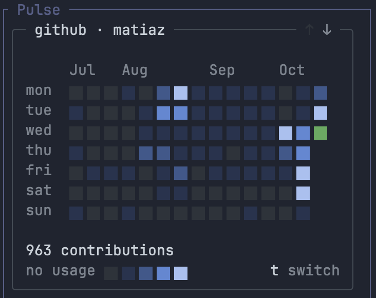
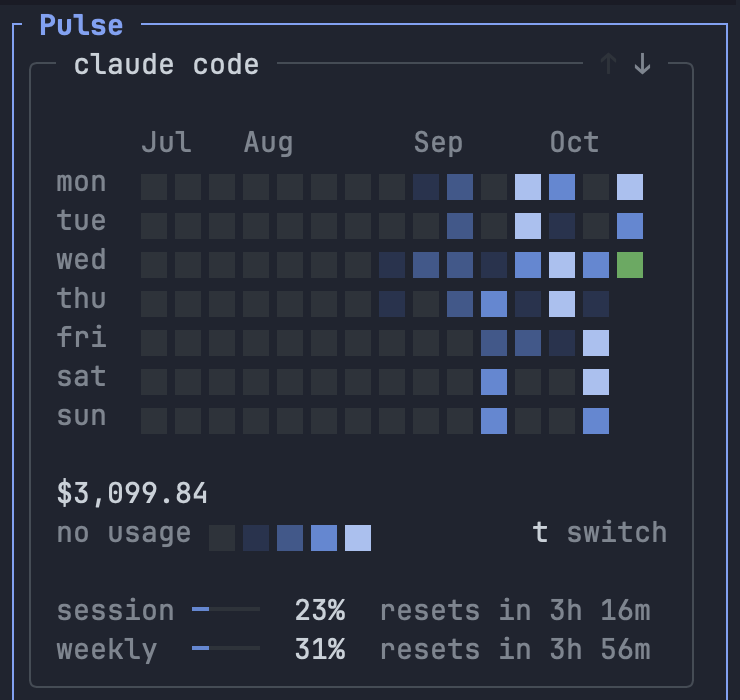
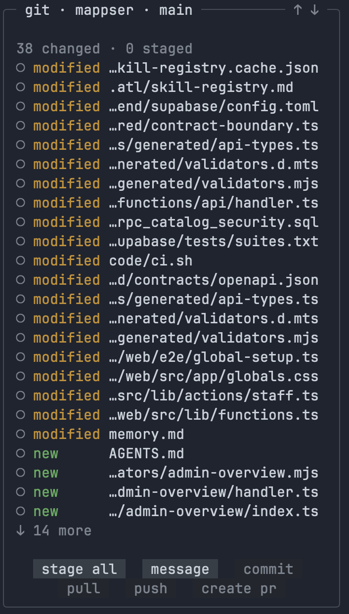

# Pulse

A side dock for [Herdr](https://herdr.dev) that keeps three things in view while you work:

- **Activity heatmap.** Your GitHub contributions or your Claude Code usage, drawn as a contribution calendar.
- **Pull requests.** Every open PR you authored, are assigned to, or have been asked to review, with what it needs from you next. Claude Code can review them and post the review on GitHub, on a double-click or automatically when your review is requested, and Pulse can merge the ones it reviewed once GitHub says they are ready.
- **Git.** The changes in the folder you are working in, with buttons to stage, write a commit message with Claude, commit, pull, push, and open a pull request that Claude describes, plus the CI result of your last push.

Each panel sits in its own box. You can reorder and collapse the boxes, and Pulse remembers the order, which boxes are collapsed, and the dock width.

<p align="center">
  
  
  
</p>

## No configuration needed

Pulse uses the tools and accounts you are already logged into:

| Panel | Where its data comes from |
| --- | --- |
| Activity heatmap, GitHub view | The GitHub account the GitHub CLI is logged into. Check it with `gh auth status`. If you switch accounts with `gh auth switch`, Pulse follows. |
| Activity heatmap, Claude Code view | The Claude Code session transcripts on this computer, in `~/.claude/projects`. |
| Claude plan usage | Your existing Claude Code login. |
| Pull requests | The same `gh` account as the heatmap. |
| Git | The folder of the pane you are focused on in the same tab. Commits use the name and email your git is configured with for that repository. |
| Commit messages, pull request descriptions and pull request reviews | Your existing Claude Code login. Reviews post to GitHub with the same `gh` account. |

There is nothing to set up inside Pulse: no tokens, usernames or paths. If you want to change how it behaves, see [Settings](#settings).

## Requirements

| Tool | Needed for | Notes |
| --- | --- | --- |
| Herdr 0.9.3 or newer | everything | |
| Node.js 20 or newer | everything | Pulse has no npm dependencies and no build step. |
| [GitHub CLI](https://cli.github.com) (`gh`) | heatmap, pull requests | Log in once with `gh auth login`. |
| `git` | git panel | |
| [Claude Code](https://claude.com/claude-code) (`claude`) | commit messages, pull request descriptions, pull request reviews | Optional. Only the **message** and **create pr** buttons and pull request reviews need it. Reviews also need the official `code-review` plugin: `/plugin install code-review@claude-plugins-official`. |
| `pbcopy` (macOS), or `wl-copy`, `xclip` or `xsel` (Linux) | copying PR links | |

Pulse runs on macOS and Linux.

## Install

```sh
herdr plugin install matiaz/herdr-pulse
```

Herdr shows the manifest before installing. Pulse runs no build commands.

This follows the default branch, so updates bring you the newest changes. To stay on a release instead, pin its tag:

```sh
herdr plugin install matiaz/herdr-pulse --ref v0.3.0
```

Releases are tagged `vX.Y.Z` and listed in [CHANGELOG.md](CHANGELOG.md). `herdr plugin list` shows the version you have.

### Updating

Herdr does not update plugins on its own. To get the latest version, run:

```sh
herdr plugin update matiaz.pulse
```

`plugin update` fetches again the ref you installed from: the default branch, or the tag you pinned. A pinned tag never moves, so to move to a newer release, install again with the new tag:

```sh
herdr plugin install matiaz/herdr-pulse --ref v0.4.0
```

If your Herdr has no `plugin update` command, run the install command again instead. Either way, Herdr keeps your settings, and a dock that is already open keeps running the old version until you close it and open it again.

## Showing and hiding the dock

**When Herdr starts,** Pulse opens on the right edge of the tab you are looking at. Your focus stays in the pane you were using. If Herdr restarted, for example after your computer was shut down, Pulse also brings its dock back in every other tab where it was open, instead of leaving an empty terminal there.

**To show or hide it** at any time, bind the plugin's toggle action to a key. Add this to `~/.config/herdr/config.toml`:

```toml
[[keys.command]]
key = "prefix+a"
type = "plugin_action"
command = "matiaz.pulse.toggle"
description = "toggle pulse"
```

Now press your Herdr prefix (`ctrl+b` by default), then `a`. The same keys open the dock when it is hidden and close it when it is showing. Use any free key instead of `a` if you prefer.

**To use a command instead,** add an alias to your shell config (`~/.zshrc` or `~/.bashrc`):

```sh
alias pulse='herdr plugin action invoke toggle --plugin matiaz.pulse'
```

Open a new shell, then type `pulse` in any pane inside Herdr to show or hide the dock.

The dock belongs to one tab. Toggling it in another tab opens a separate dock there. Closing it loses nothing: it comes back with the same box order and width.

**To refresh everything at once,** from anywhere in Herdr, bind the `refresh` action the same way:

```toml
[[keys.command]]
key = "prefix+r"
type = "plugin_action"
command = "matiaz.pulse.refresh"
description = "refresh pulse"
```

or add `alias pulse-refresh='herdr plugin action invoke refresh --plugin matiaz.pulse'`. Every open dock refreshes all its boxes, as if you pressed `r` in each.

## Panels

### Activity heatmap

Weeks run left to right and weekdays top to bottom. Today is green and days with no activity are dim squares. Hover over a day to see its exact value. The total under the calendar covers the weeks on screen.

Click **t switch**, or press `t`, to change between the two views. Until you pick one, the dock shows the view set by `heatmap.defaultSource`; after that it remembers your choice.

- **GitHub** shows the contribution counts from your GitHub profile calendar.
- **Claude Code** shows the estimated cost per day of your Claude Code usage, priced at public API rates. It is an estimate of what the usage would cost on the API, not a bill, and it only covers this computer.

The Claude Code view also shows how much of your plan you have used, under the legend:

```
session ━━━━━━━━   8%  resets in 2h 38m
weekly  ━━━━━━━━  13%  resets Wed 12:00
```

- **session** is the current 5-hour usage window and when it resets.
- **weekly** is the 7-day limit and when it resets, in your local time.

These are the same numbers Claude Code's `/usage` shows. They refresh every 2 minutes, whichever view is showing, so the [sidebar token](#sidebar-token-and-notifications) stays current; press `r` to refresh now. After a 401, 403 or 429 from Anthropic, Pulse waits 10 minutes before asking again. The bar turns yellow at 70% and red at 90%. This needs a Claude Pro or Max login in Claude Code. With an API key login there is no plan to measure, so Pulse shows a short note instead. Set `claude.planLimits` to `false` and Pulse never reads your Claude Code login token and shows no bars.

Claude Code deletes transcripts older than 30 days by default. Pulse keeps its own daily totals from the first time it runs, so the calendar keeps your history after the transcripts are gone.

### Pull requests

This box lists the open pull requests on GitHub where you are the author, an assignee, or a requested reviewer. Each one shows its repository and number, such as `owner/repo#123`, its author and its title. To open it from a terminal, run `gh pr view 123 --repo owner/repo`.

`pulls.scope` picks which of them the list shows. A PR matches a folder when its `owner/name` equals the GitHub repository of that folder's `origin` remote, ignoring case. The folders are the ones your Herdr panes are in.

| Value | Shows |
| --- | --- |
| `open` (default) | PRs in repositories open in any Herdr pane. |
| `workspace` | PRs in the repository of the pane you are focused on in the dock's tab. Empty, with a note, when that folder has no GitHub remote. |
| `all` | Every PR from the searches, in any repository `gh` can see. |

Notifications and the sidebar token use the same list.

The label on the right says what the PR needs next. The most urgent ones come first:

| Label | Meaning |
| --- | --- |
| `merge` | Checks pass and it is ready to merge. |
| `ci failed` | A check failed. |
| `conflict` | It has merge conflicts with its base branch. |
| `changes` | A reviewer requested changes. |
| `update` | The branch is behind its base. |
| `review` | Someone asked for your review. |
| `ci running` | Checks are still running. |
| `waiting` | Waiting on reviewers. |
| `draft` | Still a draft. |

- **Click** a pull request to copy its URL. The box title briefly confirms it.
- Press **`o`** to open the last pull request you clicked in your browser.
- **Double-click** it to have Claude Code review it. The box title asks **Run review?**; double-click the same pull request again within 3 seconds to start. See [Review](#review).

A row shows a short warning under the title when an automatic merge failed or was skipped. See [Auto merge](#auto-merge).

The list refreshes every 2 minutes. Press `r` to refresh now.

#### Review

Pulse starts Claude Code with the `code-review` plugin's `/code-review:code-review <url>` command, which scores each issue from 0 to 100, and Claude then posts the result with your `gh` account. When one of your Herdr panes is in a folder whose `origin` is the pull request's repository, the review opens in a new tab of that workspace, in that folder. Otherwise it opens a new Herdr workspace named `review owner/repo#123` in `~/.local/state/herdr/plugins/matiaz.pulse/reviews/`, so the first time Claude Code asks you to trust that folder. The session stays open so you can follow along or step in.

What it posts depends on `reviews.autoApprove` (off by default):

| Situation | Approve off (default) | Approve on |
| --- | --- | --- |
| Someone else's PR, an issue scored 80 or more | One review with **Request changes**, a short body and one inline comment per issue, on the head commit. No loop. | The same review, then a follow-up loop. |
| Someone else's PR, nothing scored 80 or more | A comment review: "No issues found." | An approval: "Looks good to me". No loop. |
| Your own PR | GitHub does not let you approve or request changes on your own PR, so it posts the findings as a comment review with inline comments, or a "Looks good to me" comment. No loop. | Same. |
| The PR is closed, a draft, or you already reviewed it | Nothing. | Nothing. |

The agent never merges. The follow-up loop (approve on only) runs Claude Code's `/loop` in the same session, every `reviews.loopMinutes` minutes (10 by default). Each run reads the PR's state, your review threads and the commits since the reviewed one. It stops without posting if the PR was merged or closed. It approves ("All feedback addressed. Looks good to me.") and stops only when every thread you started is resolved or answered and the PR has new commits or every point was answered without a code change. Otherwise it posts nothing and waits for the next run. The loop lives in that Claude Code session, so keep its tab open.

Pulse gives the agent no pre-approved tools, so Claude Code asks before it runs `gh` or anything else, according to your own Claude Code settings. Nothing it posts mentions Claude or AI.

#### Auto review

With `reviews.auto` on (the default), Pulse starts the same review by itself after each refresh, for at most one pull request per refresh. A pull request qualifies when:

- someone requested your review on it, it is not a draft and you did not author it;
- its repository is the `origin` of a folder open in a Herdr pane (whatever `pulls.scope` is set to), and the review runs in that workspace;
- you have not reviewed it yet on GitHub;
- Pulse has not started a review for it before, automatically or by double-click.

Automatic reviews open in the background without taking your focus, and Pulse shows a notification, "Pulse started reviewing repo#123". If the agent cannot be started, the box title briefly shows the error and Pulse does not try that pull request again.

#### Auto merge

With `reviews.autoMerge` on (off by default), Pulse merges a pull request after a refresh when all of these hold:

- Pulse started a review for it, automatically or by double-click;
- GitHub's review decision is **Approved**, and your own latest review is an approval of the current head commit;
- GitHub reports the merge state as clean and the checks on the head commit passed. Pull requests without checks are not merged.

Right before merging, Pulse fetches the pull request again and checks every condition. It then runs `gh pr merge <url> --squash` (or `--merge` / `--rebase`, from `reviews.mergeMethod`) with `--match-head-commit`, so GitHub refuses the merge if new commits arrived. It never passes `--admin` and never deletes the branch. At most one pull request is merged per refresh.

A successful merge sends "Pulse merged repo#123". A failed merge shows the error on the row and sends a notification; Pulse tries again only after the head commit or the merge state changes. If the repository does not allow the chosen merge method, the row says so and nothing is merged. With approve off and merge on, you approve by hand and Pulse merges afterwards.

### Git

This box follows the pane you are focused on in the same tab. When that pane's folder is inside a git repository with a GitHub remote, the box shows the repository name, the branch, and every changed file.

When the folder is not a repository itself but holds repositories up to three levels down, such as a parent folder you opened to work across several projects, the box shows the repository where files changed most recently. It moves to another repository when files change there. Use **‹ ›** at the top of the box to switch by hand, or **all repos** to see a list of every repository with its branch and number of changed files; click one to open it. When none of them have changes, the box starts on that list. If the folder holds no repositories with a GitHub remote, the box hides itself.

Each file shows what happened to it:

| Label | Color | Meaning |
| --- | --- | --- |
| `modified` | yellow | Changed. |
| `added` | green | New and staged. |
| `new` | green | New and not tracked by git yet. |
| `deleted` | red | Removed. |
| `renamed` | blue | Moved or renamed. |
| `conflict` | red | Has unresolved merge conflicts. |

The mark before it says whether it is staged: `●` staged, `◐` partly staged, `○` not staged.

The buttons sit at the bottom of the box in two rows. The top row is for your local work:

1. **stage all** stages every change, including new and deleted files (`git add -A`).
2. **message** asks Claude to describe your changes in one or two sentences. Claude reads the staged changes, or every change if nothing is staged yet. The message appears under the buttons as `branch-name: message`, so you can read it before committing. The button is hidden when `git.aiMessages` is `false`.
3. **commit** commits the staged files with that message. If you did not generate one, it uses just the branch name as the message. The button stays disabled until something is staged.

The bottom row talks to GitHub:

1. **pull** brings in commits from the remote. It only fast-forwards, so it never creates a merge commit or rebases your work. If your branch and the remote have diverged, or the incoming commits would overwrite files you changed, Pulse tells you instead of guessing. The button stays disabled until the remote has something new.
2. **push** pushes the branch to its remote. The first push of a new branch sets its upstream (`git push --set-upstream origin branch-name`); after that it is a plain `git push`. The button stays disabled until there is something to push. Pulse never force-pushes: if the remote has commits you don't have, the push is rejected and Pulse tells you to pull first.
3. **create pr** opens a pull request for the branch into the repository's default branch. Claude writes the title and the description from the branch's commits and changes, the same way **message** writes commit messages, and the PR is created right away. If the repository has a pull request template, Claude fills it in and keeps its headings and checklists, ticking only the items the changes clearly support. Pulse reads the template from the base branch in the same places GitHub looks: `.github/`, the repository root, then `docs/`. In a `PULL_REQUEST_TEMPLATE/` folder with several templates, it uses `default.md`, or the first one by name. Without a template, the description is a short summary with a few bullet points. When `git.aiMessages` is `false`, Claude is not used and the pull request is created with `gh pr create --fill`, which takes the title and description from the commits. The button is enabled once the branch is pushed and has no open pull request. When a pull request already exists, the button reads **pr #42** and opens it in your browser.

The box title shows how far you are from the remote: `↑2` means two commits waiting to be pushed, `↓1` means one new commit to pull. To know about new commits, Pulse runs `git fetch` in the background every 2 minutes for the repository you are focused on.

Above the buttons, a line shows the pull request for the branch and the CI result for your latest pushed commit, such as `PR #42 · ✓ checks passed`, `● checks running` or `✗ checks failed`. Click it to open the pull request, or the commit's checks when there is no pull request. It refreshes every minute and right after a push.

After a commit, the message preview and the list clear and the box shows the new commit's short hash.

While any button is working, a small hexagon animation shows what is happening and every button is disabled. A double tap cannot create two commits, two pushes or two pull requests.

Pull, push and fetch use the credentials your git already has, such as an SSH key in your agent or a credential helper. Pulse cannot answer a password or passphrase prompt, so if git needs one, the command fails with a message instead of waiting. Run it once from a terminal to unlock it, then the buttons work.

> Pulse runs git with hooks disabled, so `pre-commit`, `commit-msg` and `pre-push` hooks do **not** run for commits, pulls and pushes made from the dock. Use a terminal when you need them.

The automatic git work in the background never runs commands defined by the repository's own git config:

- **Status** is paused for repositories whose local config defines `filter.*` drivers (Git LFS installed with `--local`, for example) or `include` directives. The box then shows the branch with the note "Automatic status is paused…" instead of the file list. Stage, commit, pull and push still work.
- **Fetch** runs only when every key in the repository's local config is on a short list of known safe keys (remotes, branch tracking, user name and email, and similar). Otherwise it is skipped and the box says "Background fetch is off for this repo…" with the key that stopped it. Fetch never goes into submodules.

### Arranging the boxes

Click `↑` or `↓` in a box's title to move it, or drag a title onto another box. Click the `▾` at the start of a title to collapse the box to its title line, and `▸` to expand it again. Pulse remembers the order, which boxes are collapsed, and the dock width if you resize it, for next time.

### Sidebar token and notifications

- **Sidebar token.** With several docks open, one of them runs auto review, auto merge, notifications and the sidebar token, so nothing happens twice. After each pull request refresh, Pulse reports a `pulse` metadata token on every Herdr workspace: the most urgent pull request count for that workspace's repositories, such as `2 to merge` or `1 CI failed`, plus the 5-hour plan usage when plan limits are on, such as `5h 63%`. It is cleared when there is nothing to show. To see it in the sidebar, add `$pulse` to your Space rows in `~/.config/herdr/config.toml` (Herdr versions with sidebar row layouts):

  ```toml
  [ui.sidebar.spaces]
  rows = [
    ["state_icon", "workspace"],
    ["branch", "git_status"],
    ["$pulse"],
  ]
  ```

- **Notifications.** A Herdr notification when a pull request newly becomes `merge` (**Ready to merge**) or `ci failed` (**CI failed**), at most 5 per refresh, and when Pulse starts a review, merges a pull request or fails to merge one. Set `notifications.prs` to `false` to turn them off.

## Settings

Settings live in `config.json` in Pulse's Herdr config folder, `~/.config/herdr/plugins/config/matiaz.pulse/` (`herdr plugin config-dir matiaz.pulse` prints it). The file is optional: anything missing or invalid uses the default, and changes apply on the next refresh without reopening the dock. Keys can be written flat or nested:

```json
{
  "reviews.autoApprove": true,
  "reviews": { "mergeMethod": "rebase" },
  "pulls.scope": "all"
}
```

| Key | Default | Meaning |
| --- | --- | --- |
| `claude.planLimits` | `true` | Read the Claude Code login token and fetch 5-hour and 7-day usage from `api.anthropic.com`. |
| `heatmap.defaultSource` | `github` | View shown until you pick one: `github` or `claude`. After you pick, the dock remembers your choice. |
| `notifications.prs` | `true` | Herdr notification when a pull request becomes ready to merge or its CI fails, and when Pulse starts a review or merges. |
| `git.aiMessages` | `true` | Show **message** and let **create pr** write the title and description with your local `claude` CLI. When `false`, **create pr** uses `gh pr create --fill`. |
| `claude.configDir` | `""` | Absolute path to the Claude Code config folder, used for transcripts and (outside macOS) credentials. Empty uses `$CLAUDE_CONFIG_DIR`, otherwise `~/.claude`. |
| `pulls.scope` | `open` | `workspace`, `open` or `all`. See [Pull requests](#pull-requests). |
| `reviews.auto` | `true` | Start the review on pull requests that request your review, without a double-click. See [Auto review](#auto-review). |
| `reviews.autoApprove` | `false` | Let reviews approve clean pull requests and run the follow-up loop. Applies to automatic reviews and double-click reviews. |
| `reviews.autoMerge` | `false` | Merge pull requests Pulse reviewed once GitHub says they are ready. See [Auto merge](#auto-merge). |
| `reviews.mergeMethod` | `squash` | `squash`, `merge` or `rebase`, passed to `gh pr merge`. |
| `reviews.loopMinutes` | `10` | How often the follow-up loop runs, from 1 to 1440 minutes. Applies to reviews started after the change. |

## Privacy and data

Pulse keeps everything on your computer and has no server of its own.

- **What it stores.** Caches and preferences go in Herdr's plugin state directory, `~/.local/state/herdr/plugins/matiaz.pulse/`. That is your contribution counts, your daily Claude Code cost totals, your last plan usage percentages, your open pull request list, the pull requests Pulse started a review for with any merge errors (`reviews.json`, entries dropped 14 days after the pull request leaves the list), the box order, which boxes are collapsed, and the dock width. Your settings are in the config folder under [Settings](#settings). Only your user account can read it. Nothing is written to the plugin's own folder.
- **What it sends to GitHub.** Read-only queries through your `gh` login, for your contribution calendar, your open pull requests, and the pull request and CI state of the branch you are on. In the background, `git fetch` for the repository you are focused on. When you press **pull** or **push**, git talks to your remote the same way it does from a terminal. When you press **create pr**, `gh pr create` opens the pull request with the title and description Claude wrote. When you confirm a review, or when auto review starts one (on by default), the Claude Code session reads the pull request and posts its review, inline comments, comment, approval or change request through your `gh` login. That session has no pre-approved tools, so Claude Code asks before acting, according to your own Claude Code settings. With `reviews.autoMerge` on, Pulse runs `gh pr merge` for the pull requests it reviewed.
- **What it sends to Anthropic.** While `claude.planLimits` is on (the default), a read-only request for your plan usage every 2 minutes, paused for 10 minutes after a 401, 403 or 429. It reads Claude Code's login token from the macOS keychain, or from `~/.claude/.credentials.json` on Linux, and only sends it to `api.anthropic.com`. Pulse never refreshes or stores the token: if it has expired, open Claude Code once and Pulse picks up the new one. Nothing else goes to Anthropic unless you press **message** or **create pr**, or a review runs. For **create pr**, the branch's commit messages, the repository's pull request template if it has one, and its diff against the default branch, cut to 24 KB, go to Claude, with the same files left out as below. For **message**, the staged diff (or the unstaged diff if nothing is staged), cut to 24 KB, and the list of changed file names go to Claude through your Claude Code login. Files whose paths look like secrets or noise are left out of what is sent: `.env*`, keys and certificates such as `*.pem`, `*.key`, `*.p8`, `*.p12`, `*.ppk`, `*.gpg`, `*.asc`, `id_rsa` or `id_dsa`, `.ovpn` profiles, `kubeconfig`, `*service-account*.json`, `.htpasswd`, `.dockercfg`, `.netrc`, `.npmrc`, Terraform state, lockfiles, and any path containing `secret` or `credential`. The filter goes by file name only: a secret inside an ordinary file is sent. The request runs without tools, hooks, MCP servers or session history.
- **What it runs.** `gh`, `git`, `claude`, `herdr`, and your clipboard and browser openers. It runs them directly, never through a shell, except pull request reviews, which type a quoted `claude` command into the new workspace's shell. Git runs with hooks and `core.fsmonitor` turned off, without external diff or textconv drivers, without a pager, without inheriting your `GIT_*` environment variables, and without taking the index lock. Background status and fetch also stop for repositories whose local config could run programs (see [Git](#git)), so watching a repository never runs that repository's configured programs or blocks your own git commands. Notifications and the sidebar token go through `herdr notification show` and `herdr workspace report-metadata`.
- **What it shows.** Pull request titles, branch names and file names can come from other people, so Pulse strips terminal control characters from them before drawing.

To remove all local data, delete the state directory above.

## How it is built

```
herdr-plugin.toml   manifest: the dock pane, the toggle and refresh actions, the startup hook
bin/run.sh          puts common install locations on PATH, then runs node
app.mjs             the dock: layout, boxes, mouse and keyboard
dock.mjs            opens, closes and sizes the dock pane through the herdr CLI
refresh.mjs         the refresh action: asks every open dock to refresh
sections/           one file per box: what it draws and how it reacts to input
sources/            data for each box: GitHub, Claude Code transcripts and plan usage, pull requests, reviews, merges, git
lib/                settings, state files, git safety, Herdr panes, notifications, the sidebar token, terminal drawing, opening links
```

To work on it locally:

```sh
git clone https://github.com/matiaz/herdr-pulse
herdr plugin link ./herdr-pulse
```

Linked plugins run straight from your clone, so close and reopen the dock to pick up changes.

## License

[MIT](LICENSE)
